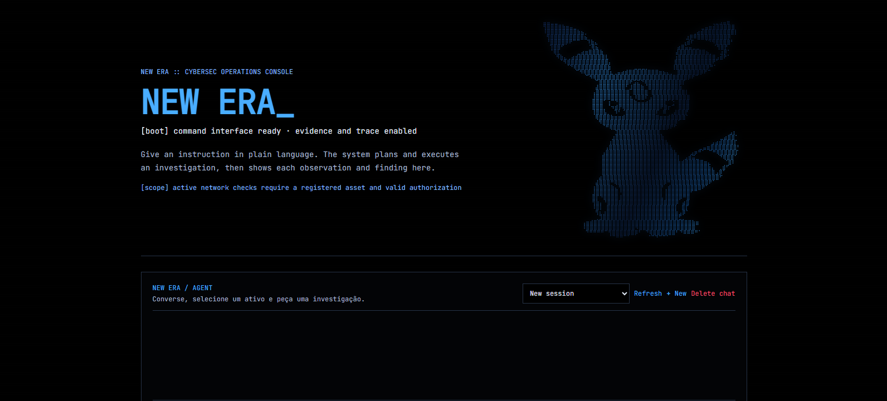
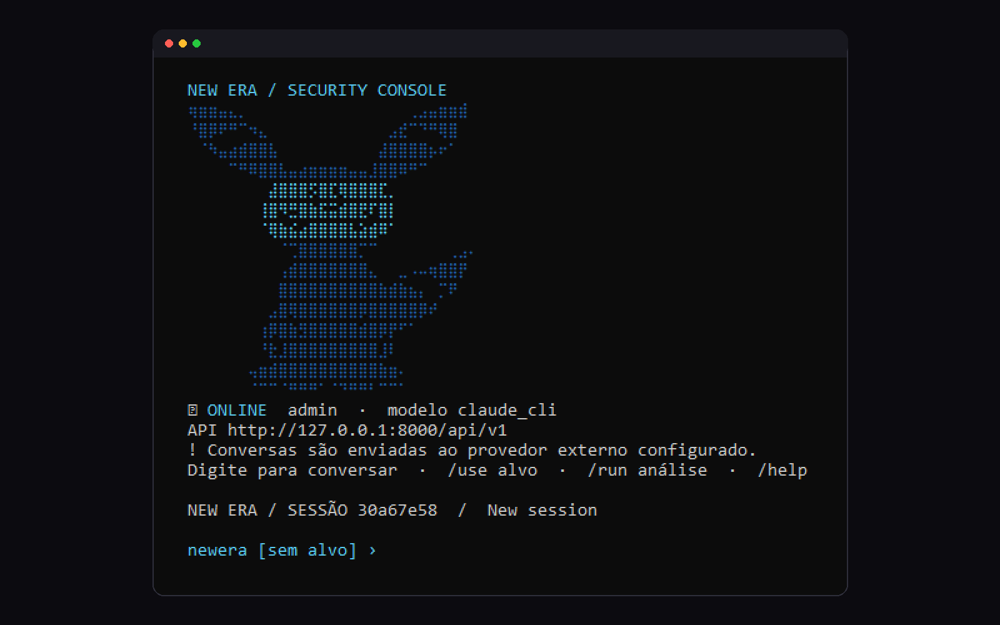

<div align="center">

# NEW ERA

**Um agente de IA para desenvolvimento de software e segurança defensiva. O modelo decide; o servidor autoriza.**

[English](README.md) · **Português**




</div>

> **Repositório vitrine.** O código-fonte é privado. Posso apresentar o projeto ao vivo ou liberar acesso para recrutadores: [brnrdcontact@gmail.com](mailto:brnrdcontact@gmail.com).

Você conversa com o NEW ERA em linguagem natural. Ele planeja, chama ferramentas tipadas que o servidor valida e responde com a evidência por trás de cada resultado. As investigações guardam o rastro completo de cada observação e achado.

## Sumário

[Duas interfaces](#duas-interfaces-uma-sessão) · [O que faz](#o-que-o-agente-faz) · [Design](#design-o-modelo-decide-o-servidor-autoriza) · [Engenharia de segurança](#engenharia-de-segurança) · [Guardrail Lab](#guardrail-lab-avaliação-de-segurança-de-ia) · [Arquitetura](#arquitetura) · [Validação](#validação)

## Duas interfaces, uma sessão

O **Command Center** na web e o **CLI** `newera` compartilham as mesmas conversas salvas: você começa no terminal, continua no navegador, e os dois lados veem o mesmo histórico, as mesmas chamadas de ferramenta e os mesmos resultados.

<p align="center">
  
</p>

## O que o agente faz

O agente trabalha com um **registro único de 36 ferramentas tipadas no servidor**. O modelo escolhe a ferramenta; o servidor confere cada argumento, permissão e escopo antes de qualquer execução.

| Área | Exemplos |
|---|---|
| **Código** | Navegar e buscar num projeto, ler `git status` / `git diff`, rodar os testes do próprio projeto num sandbox limitado (ambiente limpo, limites de recurso, timeout) |
| **Pesquisa** | Busca na web e leitura de páginas por um fetcher protegido contra SSRF; o conteúdo baixado é tratado como dado não confiável |
| **Planejamento** | Orçamento explícito de passos e tempo por turno, notas com `think`, skills carregadas sob demanda e `delegate` para um subagente com contexto limpo e orçamento próprio |
| **Análise de logs** | auth.log/syslog, Apache/Nginx, JSON, CSV e exportações de eventos do Windows; 15 detecções determinísticas (força bruta com janela de tempo, password spraying, sucesso depois de falhas, payloads de injeção web, limpeza de log…) mapeadas no MITRE ATT&CK, com sugestão de regras Sigma e as linhas que dispararam citadas |
| **Inteligência de vulnerabilidades** | `requirements.txt`, `package.json`, lockfiles ou SBOM CycloneDX cruzados com OSV.dev, CISA KEV e NIST NVD, priorizados e com versão corrigida; *potencial* separado de *confirmado* |
| **Postura de ativos** | Para domínios seus e cadastrados: DNS, SPF/DMARC e RDAP de forma passiva; com escopo ativo explícito, checagem de TLS e revisão limitada da configuração do site (cabeçalhos de segurança, flags de cookie, CORS, conteúdo misto, bibliotecas JS desatualizadas) |
| **Triagem de arquivos** | Hashes, tipo real pelos magic bytes, extensão divergente, entropia, flags de PE e de conteúdo ativo em PDF, indicadores extraídos. A análise é estática; nada é executado |
| **Correlação e conhecimento** | Indicadores que aparecem em mais de um artefato; respostas de uma base curada de ATT&CK / OWASP / NIST CSF com fontes |

Cada investigação gera um rastro persistido, achados ligados à evidência, uma tabela ATT&CK, uma nota de risco, um registro de cobertura (o que foi avaliado e o que precisa de acompanhamento), limitações explícitas e um relatório em JSON/Markdown.

## Design: o modelo decide, o servidor autoriza

- **Nenhuma permissão fica com o LLM.** Argumentos, escopos e limites são aplicados pelo código do servidor; um modelo confuso ou manipulado não consegue escalar. Não existe ferramenta de shell, e nomes de ferramenta desconhecidos são recusados.
- **Determinístico onde precisa estar certo.** Detecção, pontuação e autorização são código comum, com testes. O modelo escreve a narrativa sobre achados já validados.
- **Independente de provedor.** Claude, APIs compatíveis com OpenAI, Gemini e modelos locais (Ollama, LM Studio). Sem modelo, os fluxos determinísticos e os comandos do CLI continuam funcionando.
- **Erro que ensina em vez de derrubar.** Uma falha recuperável de ferramenta volta para o modelo como dica estruturada, e o turno continua.
- **Autorização explícita.** O padrão é consulta passiva. Qualquer checagem ativa exige um ativo cadastrado com escopo atestado e revogável, recarregado antes de cada requisição ativa.

```
mensagem ─▶ turno (orçamento) ─▶ chamada de ferramenta ─▶ validação no servidor ─▶ ferramenta ─▶ evidência ─▶ resposta / relatório
                    └─▶ delegate ─▶ subagente (contexto limpo, orçamento próprio)
```

## Engenharia de segurança

O NEW ERA recebe dados não confiáveis, acessa a internet e pode enviar dados a modelos de linguagem, o que torna a própria plataforma um alvo. Ele tem um **threat model escrito (STRIDE + ameaças específicas de LLM)**, em que cada mitigação aponta para os testes que a verificam. Destaques:

| Ameaça | Mitigação |
|---|---|
| Prompt injection pela evidência | A evidência nunca chega crua ao LLM: a etapa de narrativa recebe resumos com dados sensíveis removidos, dentro de delimitadores aleatórios, sem ferramentas e sem poder mudar planos, escopos ou aprovações. Texto com cara de instrução na evidência vira achado. |
| Alucinação do LLM | Uma checagem pós-geração remove frases que citam indicadores ausentes dos achados; a narrativa é marcada como inferência de IA. |
| Dados saindo para LLMs externos | Aprovação por investigação para provedores externos, segredos removidos antes; os modos local e offline nunca saem da máquina. |
| SSRF e DNS rebinding | Hostname normalizado, só IPs públicos, resolve uma vez e conecta no IP fixado. |
| Controle de acesso quebrado | Toda investigação, ativo, aprovação e evidência confere o dono; ID de outra pessoa retorna 404. |
| Credenciais e sessões | Hash de senha com scrypt e comparação em tempo constante, limite de tentativas de login, tokens de sessão guardados como hash HMAC, chaves de provedor criptografadas no banco. |
| Arquivos maliciosos | Guardados com chaves aleatórias de 128 bits, tipo pelos magic bytes, só parsers estáticos, nunca executados nem servidos de volta. |
| Web e cadeia de suprimentos | CSP estrita e `X-Frame-Options: DENY`; lockfiles, `pip-audit` e `npm audit` no CI; sem LangChain/LiteLLM. |

## Guardrail Lab (avaliação de segurança de IA)

Um espaço de pesquisa para medir a robustez dos guardrails de LLMs. Ele registra cada experimento com a estratégia de prompt e a resposta exatas do modelo, e recomenda o próximo experimento diferente a partir do que foi observado. Nunca declara um bypass com base em uma única resposta: resultados aparentes precisam ser repetidos em sessões novas e revisados por uma pessoa. O objetivo é avaliação reproduzível, do lado da defesa.

## Arquitetura

| Camada | Stack |
|---|---|
| API | Python 3.12 · FastAPI · Pydantic v2 · SQLAlchemy 2 (async) · Alembic · httpx |
| IA | Anthropic, compatíveis com OpenAI (OpenAI, Gemini, LM Studio), Ollama; modo offline |
| Dados | PostgreSQL 17 (SQLite em dev e testes); evidência em disco com chaves aleatórias |
| Web | React 19 · TypeScript · Vite · Tailwind CSS 4 · Server-Sent Events ao vivo |
| Ops | Docker Compose · nginx com CSP estrita · GitHub Actions (lint, testes, smoke test com Postgres, auditorias, build de imagens) |

## Validação

Suíte de testes do backend (pytest): **458 passando** em 27/10/2026, no Windows. Os 6 testes que acessam serviços externos reais ficam fora por padrão (`-m 'not network'`).

## Como usei IA

Construído com o Claude Code. Eu defini o escopo, o modelo de autorização, o threat model, os contratos das ferramentas e os fluxos, e reviso e testo os resultados.

## Status e limitações

- Projeto pessoal em desenvolvimento ativo; sem auditoria de terceiros.
- As detecções são por regra: pegam padrões conhecidos e deixam passar os novos.
- Os recursos de segurança são para os seus próprios sistemas ou com autorização por escrito.

---

<sub>Feito por <a href="https://www.bernardogomes.dev.br">Bernardo Gomes</a> · Engenharia de Software @ FIAP</sub>
